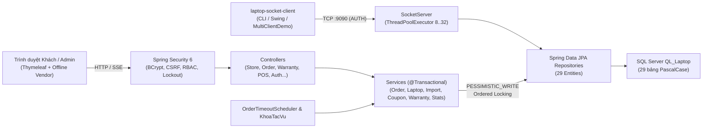
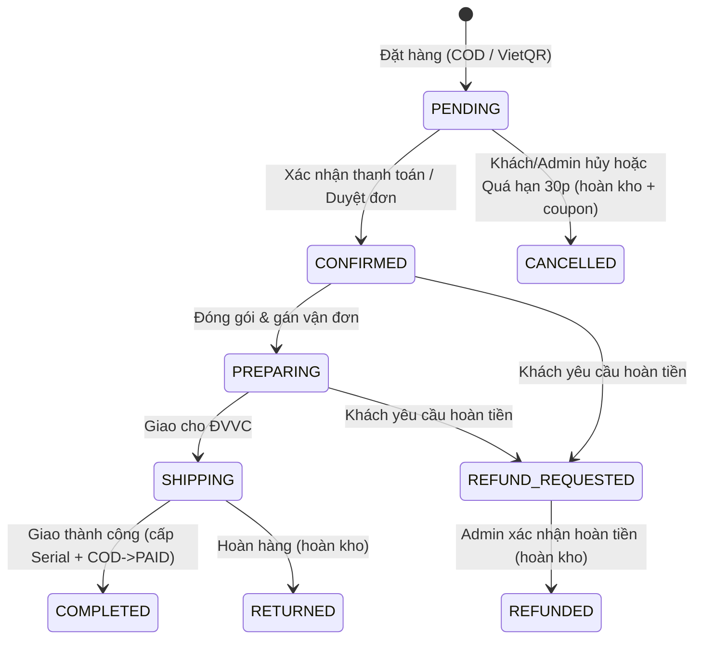
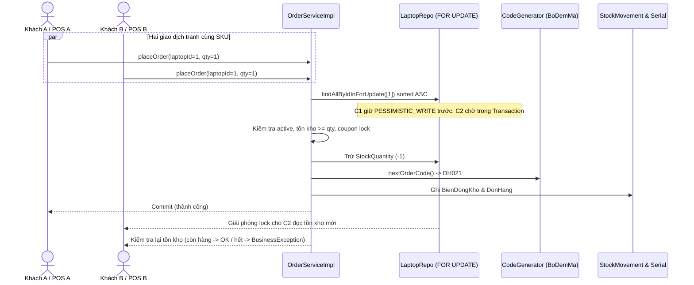

# KIẾN TRÚC HỆ THỐNG & SƠ ĐỒ NGHIỆP VỤ — NEXORA LAPTOP

## 1. Kiến trúc tổng thể (Layered CSR + Socket + SQL Server)

---

## 2. Vòng đời Trạng thái Đơn hàng (`OrderStatus`)

---

## 3. Luồng đặt hàng đồng thời an toàn (`placeOrder` + `PESSIMISTIC_WRITE`)

